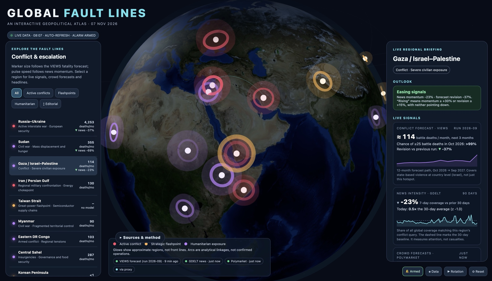

# Global Fault Lines

A live, interactive 3D atlas of 16 conflict hotspots and flashpoints. It combines academic conflict forecasts, global news momentum and prediction-market odds, and includes an optional **prep alarm** that fires on real signal thresholds.

Everything runs from one Cloudflare Worker. It serves the page, proxies and caches the data sources, and checks the alarm rules every 15 minutes, pushing alerts to your phone.



## Data sources

| Signal | Source | Refresh |
|---|---|---|
| Conflict forecast: predicted state-based battle deaths per country, 1–36 months ahead | [VIEWS](https://viewsforecasting.org) (Uppsala University / PRIO), newest run picked automatically | every 6 h (VIEWS publishes monthly) |
| News momentum + headlines: share of global coverage matching each region's conflict query | [GDELT DOC 2.0 API](https://blog.gdeltproject.org/gdelt-doc-2-0-api-debuts/) | every 15 min |
| Crowd forecasts: market-implied probabilities | [Polymarket](https://polymarket.com) Gamma API | every 3 min |
| Context | Editorial summaries; [ACLED 2026 Watchlist](https://acleddata.com/conflict-index-2026-watchlist) | static |

On the globe, **marker size** follows the VIEWS forecast (log scale) and **pulse speed** follows news momentum.

**Limits, stated plainly:** VIEWS extrapolates from recent violence. It is strong for ongoing wars and weak for sudden interstate escalation (Taiwan, Korea, the South China Sea). For those, the page relies on news momentum and market odds. Outlook labels are simple, documented threshold rules, not forecasts of specific events.

Three upstream quirks worth knowing, all verified against the live APIs:

- **GDELT rate-limits by IP and signals it with HTTP 200.** The refusal (`Please limit requests to one every 5 seconds…`) arrives with `Content-Type: application/json` but a plain-text body, so HTTP status alone cannot detect it. Both the page and the Worker surface that text instead of an opaque `JSON.parse` error; the cron stops pacing through the remaining regions after three consecutive refusals rather than burning ~88 s. On a blocked network (some cloud and CI egress IPs) the GDELT chip will stay red no matter what — the code is fine, the IP is not.
- **The VIEWS `cm/sb` endpoint ignores country filters.** `?iso=804&isoab=UKR` and no filter at all all return the same 6876 rows across 7 pages (191 countries), so the page paginates and filters client-side.
- **VIEWS has no Palestine entity.** The Gaza hotspot's forecast therefore reflects Israel (`ISR`) only; Gaza's own signal comes from news momentum and market odds.

## Prep alarm

| Level | Triggers (normal sensitivity) |
|---|---|
| **PREP**: siren, notification, checklist | Global severe-escalation coverage (war declarations, blockades, mobilization, nuclear alerts) at ≥ 3× its 7-day baseline with z ≥ 4 · a war or flashpoint region at ≥ 3× its 30-day news average with z ≥ 4 · a liquid (≥ $50k) *escalation* market rising ≥ 20 pts in 24 h or crossing 50% |
| **WATCH**: chime | Smaller versions of the above · a falling ceasefire or peace market · a VIEWS forecast revised up ≥ 50% |

Market rules are direction-aware: a ceasefire market *rising* never raises an alarm. Each rule re-fires at most every 12 h. Sensitivity can be set to low, normal or high.

The PREP checklist is Swiss-oriented: verify first via [Alertswiss](https://www.alert.swiss), then supplies per the federal BWL recommendation of 9 L water per person and food for about a week ([calculator](https://www.notvorratsrechner.bwl.admin.ch)), then devices, family plan, documents and travel.

> ⚠️ This is a derived news and market signal, **not an official warning**. False alarms are possible.

## Deploy

```bash
npm i -g wrangler && wrangler login
wrangler kv namespace create STATE        # paste the id into wrangler.toml
wrangler secret put NTFY_TOPIC            # long random topic name, e.g. gfl-<20 random chars>
wrangler deploy
```

Then:

1. Open `https://fault-lines.<you>.workers.dev`. That's the live page.
2. Install the free [ntfy](https://ntfy.sh) app and subscribe to the same topic for push alarms when the page is closed.
3. Set `PAGE_URL` in `wrangler.toml` to your workers.dev URL so that tapping an alert opens the page.

Optional secrets: `NTFY_TOKEN` (for protected or self-hosted ntfy topics) and `TEST_KEY` (enables `GET /test-push?key=…`).

## Run it locally

```bash
npx wrangler@latest dev --port 8787 --test-scheduled
```

KV is simulated locally, so no `wrangler login` is needed — but `wrangler.toml` must carry *some* value for the `STATE` namespace id (the shipped `PASTE_KV_NAMESPACE_ID_HERE` placeholder works for local dev; replace it with a real id before deploying).

Then open <http://localhost:8787> and, to exercise the alarm cron once:

```bash
curl "http://localhost:8787/__scheduled?cron=*/15+*+*+*+*"   # returns immediately
sleep 100 && curl http://localhost:8787/alarms               # the run itself takes ~90 s
```

## Endpoints

| Path | Purpose |
|---|---|
| `/` | The atlas page (same origin, so no CORS issues) |
| `/fetch?url=…` | Cached proxy, limited to VIEWS, GDELT and Polymarket |
| `/alarms` | Alarms raised by the cron in the last 48 h |
| `/health` | Status |

The HTML also works as a standalone file. GDELT can be called directly from the browser. If VIEWS or Polymarket are blocked by CORS, paste your Worker URL under **⚙ Data**.

## Files

- `global_fault_lines_v4.html`: the page (Three.js globe, live data layer, alarm engine)
- `worker.js`: Cloudflare Worker (page hosting, proxy, cron alarm, ntfy push)
- `wrangler.toml`: Worker config (cron every 15 min, KV binding, page bundled as text)
